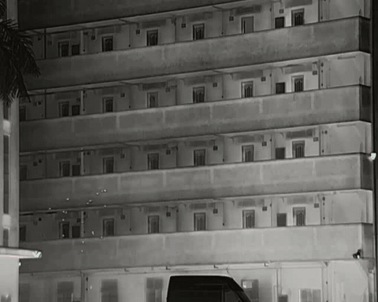

# botsort-from-scratch

BoT-SORT çoklu nesne takip algoritmasının **sıfırdan, okunabilir** bir Python uygulaması.
Aynı kod üç modda çalışır, böylece her bileşenin katkısı ayrı ayrı görülebilir:
**SORT → ByteTrack → BoT-SORT**.



*Termal IR kayıtta İHA sürüsü takibi: renkli kutular kalıcı kimlikleri, soluklaşan çizgiler
son 30 karelik izi gösterir. Tam video: [`assets/multiuav_tracked_trail.mp4`](assets/multiuav_tracked_trail.mp4)*

> Makale: Aharon, Orfaig, Bobrovsky, *BoT-SORT: Robust Associations Multi-Pedestrian Tracking*,
> 2022 ([arXiv:2206.14651](https://arxiv.org/abs/2206.14651)). Resmi kod:
> [NirAharon/BoT-SORT](https://github.com/NirAharon/BoT-SORT).

---

## Modlar

| Mod | Eklenen bileşen | Ne işe yarar |
|---|---|---|
| `sort` | Kalman + tek aşamalı IoU eşleme | Temel tracking-by-detection |
| `bytetrack` | + düşük skorlu tespitlerle **ikinci eşleme aşaması** | Kısmen örtülen / bulanıklaşan hedefte izi kaybetmez |
| `botsort` | + xywh Kalman, + **kamera hareket telafisi (CMC)**, + **IoU–ReID füzyonu** | Hareketli kamerada ve yakın hedeflerde kimlik değişimini azaltır |

## Her karede ne oluyor?

1. Tespitler skora göre ikiye bölünür: yüksek (`>= track_high_thresh`) / düşük
2. Tüm izlerin (aktif + kayıp) bir sonraki konumu Kalman ile **tahmin** edilir
3. *[BoT-SORT]* Kamera hareketi seyrek optik akış + RANSAC ile kestirilir, tahminler düzeltilir
4. **1. eşleme:** izler ↔ yüksek skorlu tespitler, maliyet = `min(IoU-mesafe, görünüm-mesafe)`
5. **2. eşleme:** kalan aktif izler ↔ düşük skorlu tespitler, sadece IoU *(ByteTrack fikri)*
6. Onaylanmamış (tek karelik) izler ↔ kalan yüksek tespitler
7. Eşleşmeyen yüksek tespitlerden yeni iz başlatılır, uzun süre kayıp kalan izler silinir

## Kurulum

```bash
git clone https://github.com/silaylc/botsort-from-scratch
cd botsort-from-scratch
pip install -e .            # numpy, scipy, opencv-python
pip install -e ".[yolo]"    # sadece --detector yolo için (ultralytics)
pip install -e ".[dev]"     # testler için (pytest, ruff)
```

## Kullanım

### Kütüphane olarak

```python
from botsort import BoTSORT

tracker = BoTSORT(mode="botsort")
for frame in frames:
    boxes, scores = my_detector(frame)            # (N,4) xyxy, (N,)
    for t in tracker.update(boxes, scores, frame):
        print(t.track_id, t.xyxy)
```

### Videoda çalıştırma

`scripts/track_video.py` üç dedektörle gelir. `motion` ve `blob` eğitilmiş model gerektirmez:

| `--detector` | Yöntem | Ne zaman |
|---|---|---|
| `motion` *(varsayılan)* | MOG2 zamansal arka plan çıkarma | Kamera **sabit**, hedef küçük ve hareketli (drone sürüsü, kuş). Hedefin parlak ya da koyu olması fark etmez. |
| `blob` | Tek karede parlaklık eşikleme | Hedef arka plandan belirgin şekilde **daha parlak** |
| `yolo` | Ultralytics YOLO | Kendi etiketli verinizle eğittiğiniz bir ağırlık varsa (COCO ağırlıkları drone tanımaz) |

```bash
# Termal IR, küçük hedefler, sabit kamera — model gerekmez
python scripts/track_video.py --video video.mp4 --detector motion \
    --no-reid --match-thresh 0.6 --out cikti.mp4

# Parlak hedef, eşikleme ile
python scripts/track_video.py --video video.mp4 --detector blob --thresh 200 \
    --no-reid --match-thresh 0.6 --out cikti.mp4

# Kendi eğittiğiniz YOLO ağırlığıyla
python scripts/track_video.py --video ir_video.mp4 --detector yolo \
    --weights kendi_agirligim.pt --no-reid --match-thresh 0.65 --conf 0.15 --out cikti.mp4
```

Tüm seçenekler için: `python scripts/track_video.py --help`

## Küçük nesne notu

Birkaç piksellik hedeflerde (ör. termal kayıttaki İHA sürüsü) varsayılan ayarlar yaya
ölçeğine göre seçildiği için kırılgandır:

- **`--no-reid`**: Termal / gri görüntüde renk histogramı anlamsızdır. BoT-SORT'u
  Kalman + CMC (ReID'siz) modunda çalıştırır; resmi kodun "BoT-SORT" (ReID'siz) varyantıdır.
- **`--match-thresh`**: Varsayılan 0.8 küçük ve titrek hedeflerde fazla katıdır;
  0.5–0.65 aralığını deneyin.
- **`--match-buffer`**: Kutuları **sadece eşleme maliyetinde** her kenardan bu kadar piksel
  büyütür. 10 piksellik bir kutu bir karede 3 piksel kayarsa IoU sert biçimde düşer;
  tampon bunu yumuşatır. İzin gerçek boyutu, görselleştirme ve Kalman kovaryansı değişmez.
  Başlangıç için kutu boyutunun 2–5 katı denenebilir. Yaya ölçekli sahnelerde 0 bırakın.
- **`--kf-pos-floor`**: Kalman'ın konum gürültüsü kutu boyutuyla orantılıdır; çok küçük
  kutularda bu neredeyse sıfıra iner ve filtre ölçümlere aşırı güvenir. Bu parametre
  piksel cinsinden bir alt sınır koyar.
- **`--trail-len`**: Her izin arkasında kaç karelik iz çizgisi gösterileceği (0 = kapalı).

`blob` dedektörünün `--thresh`, `--min-area`, `--max-area` ayarları videoya göre birkaç
kareyle denenerek seçilmelidir: hiç kutu çıkmıyorsa `--thresh` düşürülür, arka plan
gürültüsü de kutulanıyorsa yükseltilir.

## Proje yapısı

```
botsort/
├── kalman.py       KalmanFilterXYWH — sabit hız modeli, piksel tabanlı gürültü
├── gmc.py          GMC (optik akış + RANSAC) ve apply_cmc
├── reid.py         appearance_embedding — basit HSV histogramı (ReID ağı yerine)
├── matching.py     IoU matrisi, Macar algoritmasıyla eşleme, kutu dönüşümleri
├── track.py        Track — iz durumu, görünüm EMA'sı
├── tracker.py      BoTSORT — üç modlu ana döngü
├── detectors.py    blob_detect, MotionDetector (eğitimsiz dedektörler)
└── visualize.py    kutu, kimlik etiketi ve iz çizgisi çizimi
scripts/
└── track_video.py  komut satırı arayüzü
tests/              birim testler (pytest)
assets/             demo GIF ve video
```

## Testler

```bash
pytest
```

Testler IoU ve eşleme yardımcılarını, Kalman'ın hız kestirimini, üç modda iki hedefin
kimliklerinin korunmasını ve ByteTrack'in düşük skorlu tespitlerle izi sürdürürken
SORT'un kaybettiğini doğrular.

## Lisans

[MIT](LICENSE)
